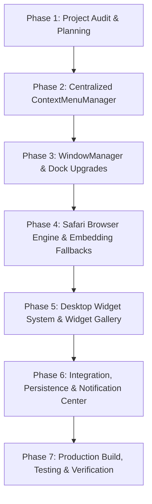

# Implementation Plan: Web macOS Operating System

---

## Task Breakdown

### Phase 1: Project Audit (Complete)
- [x] Scan workspace directories and analyze active components.
- [x] Formulate architecture diagram and dependency graph.
- [x] Generate `PROJECT_AUDIT.md`, `SYSTEM_ARCHITECTURE.md`, `IMPLEMENTATION_PLAN.md`, and `FEATURE_STATUS.md`.

### Phase 2: Centralized ContextMenuManager
- [ ] Implement `ContextMenuManager` in `MacOSDesktop.jsx`:
  - [ ] Global `pointerdown` outside-click listener with element ref detection.
  - [ ] Escape key handler.
  - [ ] Clamping logic to guarantee menu never renders outside visible viewport.
  - [ ] Desktop context menu: New Folder, New Python Script, New Java Class, Change Wallpaper, Edit Widgets, Fullscreen.
  - [ ] File & Folder context menus: Open, Open with VS Code, Rename, Move to Trash.
  - [ ] Dock icon context menu: Open, Minimize, Quit, Options.
  - [ ] Safari tab context menu: Close, Close Others, Duplicate Tab.

### Phase 3: WindowManager & Dock Enhancement
- [ ] Centralize window operations (open, close, minimize, maximize, restore, focus, z-index).
- [ ] Add double-click title bar maximize toggle.
- [ ] Add 50% left/right snap functionality.
- [ ] Persist window positions and dimensions to `localStorage`.
- [ ] Update Dock running indicator dots and active app highlight.

### Phase 4: Safari Browser Engine
- [ ] Create `frontend/src/pages/macos/apps/SafariBrowserApp.jsx`.
- [ ] Address bar parser: auto-detect URLs vs search engine queries, prefix `https://`.
- [ ] Tab management: create tab, close tab, switch tab, restore closed tab, duplicate tab.
- [ ] Navigation controls: Back, Forward, Reload, Stop, Home, animated loading progress.
- [ ] Embedding strategy:
  - Sandboxed iframe for embed-friendly websites.
  - Informative fallback page for sites blocking iframes (X-Frame-Options/CSP) with one-click "Open in Host Tab".
  - Search engine integrations (Google, DuckDuckGo, Bing).
- [ ] Bookmarks bar (add, remove, persist).
- [ ] History drawer (searchable, deletable items, clear history).
- [ ] Downloads drawer (download progress and open in Finder).
- [ ] Beautiful Apple-style Start Page with favorites and customizable quick links.

### Phase 5: Desktop Widget System
- [ ] Create `frontend/src/pages/macos/components/WidgetSystem.jsx`.
- [ ] Implement built-in interactive widgets:
  - Live Analog/Digital Clock & World Clock.
  - Weather widget with live conditions and forecast.
  - Interactive Calendar with day highlights.
  - Reminders widget with task completion tracking.
  - Notes scratchpad widget.
  - Working Calculator widget.
  - Battery indicator widget.
  - System Monitor widget with storage and RAM gauge.
  - Pomodoro focus timer widget.
  - Quick Links widget.
- [ ] Support small (1x1), medium (2x1), and large (2x2) widget sizes.
- [ ] Desktop Widget Gallery modal with category filtering, search, and "Add to Desktop".
- [ ] Persist desktop widget layouts to `localStorage`.

### Phase 6: Notification Center & Control Center
- [ ] Top-right menu bar trigger for slide-out Notification Center.
- [ ] Today View hosting widgets alongside dismissible system notifications.
- [ ] Control Center for brightness, volume, Wi-Fi, Bluetooth, and theme toggle.

### Phase 7: Build & Verification
- [ ] Compile with Vite (`npm run build`).
- [ ] Verify zero syntax or runtime bundling errors.
- [ ] Test context menu dismissal across desktop, files, and windows.
- [ ] Test Safari browser navigation, tab management, and iframe fallback.
- [ ] Test widget placement, interaction, and persistence.
- [ ] Deploy to `dist/`, touch `tmp/restart.txt`, and push commit to GitHub.
