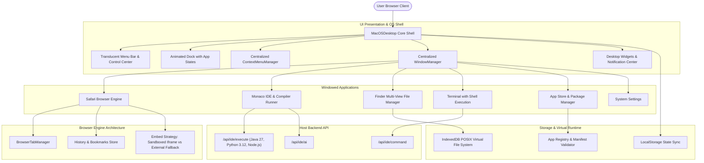

# System Architecture: macOS Web Operating System



---

## 1. Centralized ContextMenuManager Architecture
* **State Management:** A single state atom (`contextMenu: { isOpen, x, y, type, target, items }`) controlled globally.
* **Dismissal Pipeline:**
  * Global `pointerdown` listener at the window level using DOM element ref checks.
  * Closes if click target is outside the context menu element.
  * Keyboard handler listens for `Escape` and unconditionally dismisses active menus.
  * Automatic closure upon window focus change, virtual space switch, or modal opening.
* **Viewport Clamping:** Computes menu width and height against `window.innerWidth` and `window.innerHeight` to prevent offscreen rendering.

## 2. Window Manager Architecture
* **Data Model:**
  ```typescript
  interface WindowState {
    id: string;
    appId: string;
    title: string;
    isOpen: boolean;
    isMinimized: boolean;
    isMaximized: boolean;
    x: number;
    y: number;
    w: number;
    h: number;
    zIndex: number;
    prevBounds?: { x: number; y: number; w: number; h: number };
  }
  ```
* **Persistence:** Serializes window coordinates and dimensions to `localStorage.getItem('mac_window_geometry')`.
* **Snapping Engine:** Dragging to left edge (< 20px) previews and snaps to 50% left; right edge snaps to 50% right; top edge (< 26px) maximizes.

## 3. Safari Browser Engine Architecture
* **Core Problem:** Modern sites like Google, GitHub, and YouTube declare `X-Frame-Options: DENY` or `Content-Security-Policy: frame-ancestors 'none'`, causing browser iframes to fail with `ERR_BLOCKED_BY_RESPONSE`.
* **Solution Architecture:**
  * **Web Mode:** Sandboxed `<iframe>` with `sandbox="allow-scripts allow-same-origin allow-forms allow-popups"`.
  * **Intelligent Embed Detection:** Probes destination with timeout and message listeners.
  * **External Fallback Mode:** When a site cannot be embedded, presents an informative macOS-themed page explaining the security boundary with a prominent "Open in Host Browser" action, search engine alternatives, and web preview options without leaving the virtual OS.
  * **State Architecture:** Each tab maintains `{ id, url, title, history: [], historyIndex: 0, isLoading: boolean, favicon: string, isBookmarked: boolean }`.

## 4. Desktop Widget Architecture
* **Widget Container:** A responsive, draggable desktop grid that supports:
  * `small` (1x1: 160x160px)
  * `medium` (2x1: 336x160px)
  * `large` (2x2: 336x336px)
* **Standard Widgets:** Clock, World Clock, Weather, Calendar, Reminders, Notes, Calculator, Battery, System Monitor, Pomodoro, Quick Links.
* **Widget Gallery:** Modal overlay enabling users to browse, preview, select dimensions, and add or remove widgets from their desktop.
